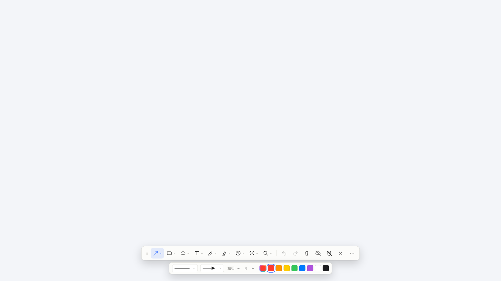
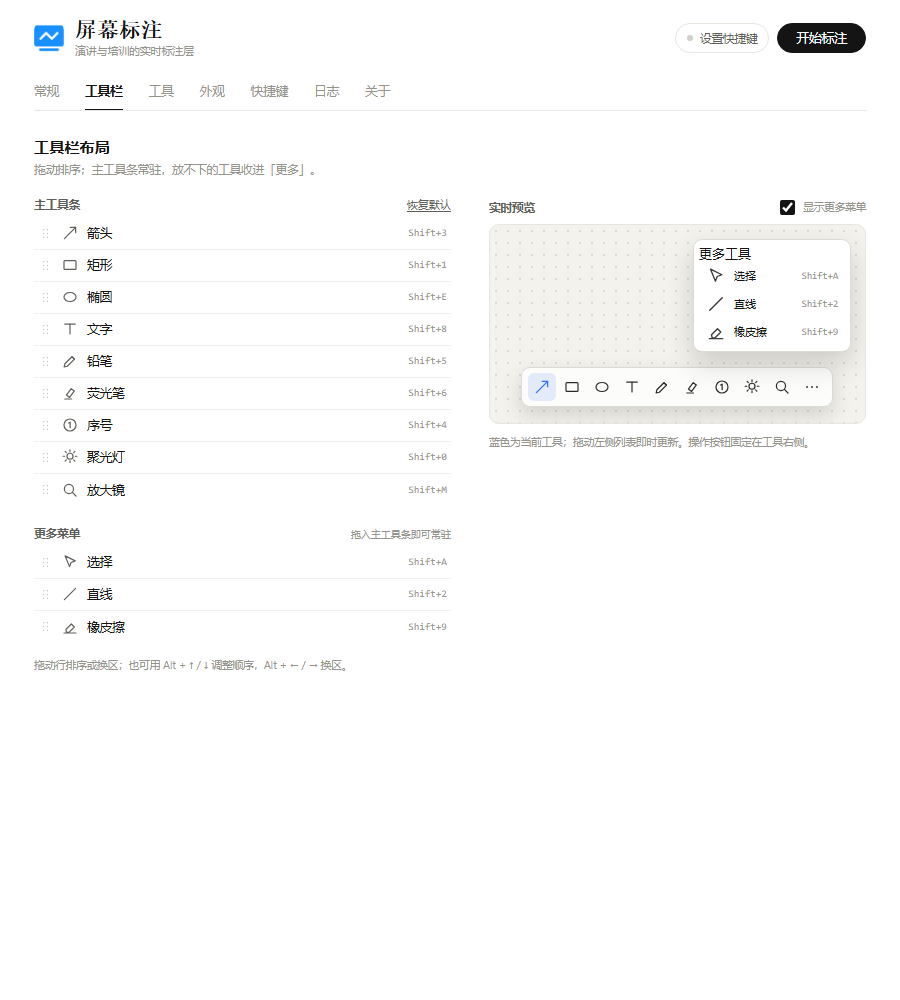
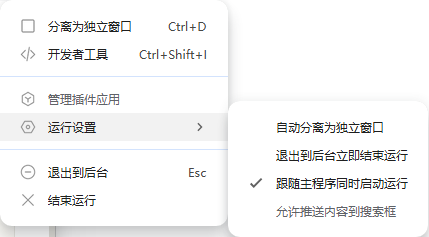

# 屏幕标注 · uTools 插件

在任意屏幕的实时画面上直接圈画、标注、放大，用于**演讲、培训、演示、远程讲解**等场景。按全局快捷键唤出全屏透明覆盖层与悬浮工具栏，画完即可隐藏或穿透，不打断正在演示的 PPT / 浏览器。

> 当前版本：`v1.0.1`

[](LICENSE)



---

## 功能

### 标注工具

| 工具 | 操作 |
| --- | --- |
| 选择 | 点击选中已有标注，拖动移动，`Delete` 删除 |
| 箭头 | 拖拽绘制，按住 `Shift` 吸附 45°；可选实心 / 开口 / 细箭头 |
| 直线 | 拖拽绘制，按住 `Shift` 吸附 45° |
| 矩形 | 拖拽绘制，按住 `Shift` 画正方形；可开关填充 |
| 椭圆 | 拖拽绘制，按住 `Shift` 画正圆；可开关填充 |
| 铅笔 | 自由绘制；按住 `Shift` 画直线；滚轮调笔宽 |
| 荧光笔 | 半透明宽笔迹，可调透明度 |
| 文字 | 点击位置输入，`Enter` 提交、`Shift+Enter` 换行、`Esc` 取消；支持字号、粗体、斜体 |
| 序号 | 点击连续放置；支持数字 / 字母 / 罗马数字 |
| 聚光灯 | 拖出区域，区域外自动压暗；只保留一层遮罩，新聚光灯替换旧的；可调遮罩浓度、描边 |
| 放大镜 | 先框选源区域，松手后短暂隐藏覆盖层截屏，再生成可拖动镜片；可调倍数与边框 |
| 橡皮擦 | 拖动经过的标注整笔删除，笔径可调 |

### 工具参数条

工具栏为两段结构：下方是主工具条，上方是当前工具的参数条。选中带参数的工具后，可以直接调整：

- 颜色、粗细、透明度、字体、字号；
- 线条样式（实线 / 虚线 / 点线 / 点划线）；
- 箭头样式（实心 / 开口 / 细箭头）；
- 矩形/椭圆填充、文字粗体/斜体、序号类型；
- 聚光灯遮罩与描边、放大镜倍数与边框。

参数会写回配置，下次进入沿用；带参数的工具按钮右下角有展开标记，悬停可看到名称、快捷键与「调整」提示。

### 会话能力

- **全屏透明置顶**：覆盖层位于演示画面之上，不遮挡底层内容。
- **目标屏幕**：默认鼠标所在屏幕，也可在配置中指定主显示器或某块显示器。
- **鼠标穿透**：`F10` 后鼠标可直接操作 PPT / 浏览器翻页，标注仍然可见；工具栏保持可见，穿透按钮变蓝，再按 `F10` 或点击该按钮退出。穿透期间点击任意工具会自动退出穿透并选中该工具；若焦点已切到其他应用，用全局快捷键恢复标注。
- **隐藏工具栏**：`F9` 隐藏/显示工具栏，保留画面与快捷键操作。
- **退出清理**：`Esc` 退出并销毁覆盖层；默认清空本次标注，关闭「退出时清空标注」后可在同一目标屏、同一次插件运行期间恢复。
- **撤销/重做**：支持多步撤销，清空、删除、移动、样式修改都可回退。

### 配置页

配置页按功能分为 8 个页签：**常规 / 工具栏 / 工具 / 外观 / 快捷键 / 使用 / 日志 / 关于**。

- **工具栏**：拖拽排序、主工具条与「更多菜单」之间拖动换区；右侧实时预览调整后的工具栏与更多菜单；支持 Alt + ↑/↓ 排序、Alt + ←/→ 换区。
- **工具**：逐工具设置默认参数（线型、箭头、填充、字号、透明度、倍数等）；支持单个工具重置，以及顶部「重置全部工具参数」（即时重置并用轻量提示反馈，不弹窗）。
- **外观**：共用颜色开关、默认颜色、色板增删改。
- **常规**：目标屏幕、退出清空、启动隐藏工具栏、默认激活工具（默认不选中，可选任意工具）。
- **快捷键**：退出/隐藏工具栏/穿透可重录；工具切换键固定。
- **使用**：完整上手流程、随 uTools 启动常驻设置截图、常用快捷键。
- **日志**：诊断日志可查看、打开目录、下载为文件；内置纯逻辑自检与诊断模式入口。
- **关于**：版本、能力概览、平台状态与本地运行说明。



---

## 环境与安装

- uTools 8.0+ 为推荐环境：放大镜（`captureDisplay`）、插件数据目录（`getPluginLocalDataPath`）、指令快捷键查询（`getCmdHotKey`）依赖 uTools 8.0 新增的 API。
- uTools 7.x 可正常启动与标注：放大镜会提示升级，日志退回用户数据目录下的 `plugin-data/screen-callout`；更早版本未验证。
- 本项目无构建步骤，`plugin.json` 直接指向根目录页面，无需 `npm install`。

### 平台支持

- **Windows**：当前主要开发与验证平台。
- **macOS**：窗口创建按 uTools 官方「全屏透明置顶窗口」示例处理——`fullscreen` 只在 Windows 下启用，macOS 使用与 `display.bounds` 等大的无边框透明窗口；`captureDisplay`、`getAllDisplays` 等屏幕 API 在官方文档中未标注平台限制。
- **尚未在 macOS 实机验证**：透明置顶能否覆盖菜单栏/Dock、屏幕录制权限、Retina 多屏对齐、输入法与快捷键行为，需要按 Spike 流程在 Mac 上实测后才能称为已支持。当前只能确认代码没有 Windows 专属调用，且窗口分支与官方示例一致。

**开发模式安装**

1. 打开 uTools → 获取并打开「uTools 开发者工具」。
2. 新建项目（填写名称、描述、平台）。
3. 在项目中选择工程目录，指向本仓库根目录的 `plugin.json`。
4. 点击「安装（开发模式）」，再点「打开」。
5. 在插件首页点「设置全局快捷键」，为「屏幕标注」指令设置快捷键（例如 `F8`）。

> 开发调试时若需要每次进入都加载最新代码，可在开发者工具项目设置中开启「退出到后台立即结束运行」；正式使用与验收时请关闭，否则覆盖层会在失焦后立即被回收。
>
> 如需让插件随 uTools 启动常驻，请在插件右键菜单中**先取消勾选**「退出到后台立即结束运行」，再勾选「跟随主程序同时启动运行」——前者勾选时 uTools 会禁用后者。该选项由 uTools 宿主控制，不属于插件配置。



---

## 使用

进入插件默认停留在配置页；点击「开始标注」或按全局快捷键才会进入标注。

1. 按全局快捷键 → 鼠标所在屏幕出现透明覆盖层与底部工具栏。
2. 默认不预选工具、不展开参数条；可在「常规 → 默认激活工具」指定进入时自动选中的工具；点选工具后图标变蓝并出现该工具的参数条，再次点击当前工具可收起/展开参数条。
3. 在画面上拖拽/点击绘制；工具条上方的参数条可调线型、颜色、字号等，滚轮调粗细。
4. 演讲中需要操作演示软件时按 `F10` 穿透，回到标注时再按一次全局快捷键。
5. `Esc` 退出标注。

### 快捷键

| 按键 | 功能 |
| --- | --- |
| `Shift+1` / `Shift+2` / `Shift+3` | 矩形 / 直线 / 箭头 |
| `Shift+4` / `Shift+5` / `Shift+6` | 序号 / 铅笔 / 荧光笔 |
| `Shift+8` / `Shift+9` / `Shift+0` | 文字 / 橡皮擦 / 聚光灯 |
| `Shift+M` / `Shift+E` / `Shift+A` | 放大镜 / 椭圆 / 选择 |
| `Ctrl+Z` / `Ctrl+Y` | 撤销 / 重做 |
| `Delete` / `Backspace` | 删除选中标注 |
| `Ctrl+Shift+Backspace` | 清空全部（可撤销） |
| `F9` / `F10` | 隐藏工具栏 / 鼠标穿透 |
| `Esc` | 退出标注（可在配置中修改） |

> 覆盖层窗口失去焦点后，其内部快捷键不再生效；恢复交互依赖 uTools 全局快捷键重新进入插件。

---

## 数据存储

配置通过 `utools.dbStorage` 保存在用户数据中（随 uTools 数据同步），键名 `screen-callout.settings.v1`，包含工具栏布局、颜色、各工具参数（`toolOptions`）、会话偏好、快捷键。

标注内容不写盘、不生成图片；默认退出即释放。关闭「退出时清空标注」后，标注只在本次插件运行期间、同一目标屏内保留，插件进程重启后不会恢复。

---

## 项目结构

```text
.
├─ plugin.json              # uTools 插件配置
├─ index.html               # 主界面：配置页
├─ overlay.html             # 覆盖层：画布 + 工具栏
├─ preload.js               # 主桥接：窗口/显示器/截图/存储/IPC
├─ overlay-preload.js       # 覆盖层桥接（最小暴露）
├─ src/
│  ├─ assets/               # 运行时图片（引导页配图）
│  ├─ shared/               # 纯逻辑：默认值、几何、撤销、配置、自检
│  ├─ main/                 # 配置页样式与控制器
│  └─ overlay/              # 覆盖层控制器、渲染、工具栏、图标、样式
├─ scripts/                 # 发布打包脚本（npm run pack）
├─ dev/                     # Spike 诊断页 + 浏览器静态预览（mock 桥接）
├─ tests/                   # Node 内置测试 + 静态一致性检查
└─ docs/                    # 功能梳理、实施方案、Spike 指引
```

技术栈为原生 HTML/CSS/JavaScript，不使用构建工具与框架；共享逻辑采用 UMD 写法，既能在页面中作为普通脚本加载，也能被 Node 测试直接 `require`。

---

## 开发与测试

```bash
npm test        # node --test：单元测试 + 静态检查
```

测试覆盖：矩形归一化、图形命中测试、放大镜布局与裁剪换算、撤销/重做、配置清洗与旧版迁移、工具栏拖拽插入、序号格式、快捷键解析、内置自检、uTools 版本兼容层（8.0 新增 API 缺失时的降级），以及 `plugin.json`/页面脚本引用的一致性。

浏览器静态预览（不依赖 uTools，使用 mock 桥接）：

- `dev/preview.html`：直接看到工具栏、参数条与各类标注的渲染效果；`?arrow=1` 可直接展开线型菜单。
- `index.html?tab=toolbar` / `?tab=tools`：在普通浏览器里预览配置页某个页签；
- 兜底说明：预览页只验证页面逻辑与视觉，不验证 uTools 运行时行为。

---

## 发布

uTools 开发者工具「发布新版本」会打包所选文件夹下的全部文件，且不允许包含 `.git` 版本控制文件夹，因此不能直接选仓库根目录。发布前先生成干净的发布目录：

```bash
npm run pack    # 按白名单生成 release/，并校验配置与页面引用
```

脚本只复制运行时文件（`plugin.json`、`logo.png`、`index.html`、`overlay.html`、两个 preload 与 `src/`），不会带入 `.git`、`dev/`、`tests/`、`docs/`；校验不通过会以非零退出码结束。`release/` 已加入 `.gitignore`，不纳入版本管理。

随后在 uTools 开发者工具中点击「发布新版本」：

1. 版本号填写与 `package.json` 一致的版本（`npm run pack` 会打印当前版本）；
2. 点击文件夹图标，把打包目录改选为仓库下的 `release`；
3. 点击「下一步」。

每次改完代码重新执行 `npm run pack` 再发布，避免 `release/` 残留旧文件。

---

## 验证状态与已知限制

**已验证（本机自动化）**：JS 语法检查、52 项单元/静态测试、模拟旧版 uTools（缺少 8.0 新增 API）的 preload 启动验证、浏览器中的工具栏/参数条/线型菜单渲染、撤销回退、配置页 8 个页签与实时预览布局。

**待实机验证（uTools 运行时）**：透明置顶窗口、全局快捷键重入恢复、中文输入法、`captureDisplay` 是否捕获到覆盖层自身、长时间演讲存活、多显示器与高 DPI 对齐。这些项按 [Spike 运行指引](docs/03-Spike运行指引.md) 执行；在通过前不应视为已验收。

**当前版本不做**：

- 截图、贴图/钉图、保存/复制图片、OCR、翻译、水印、马赛克；
- 多块屏幕同时覆盖（一次只覆盖一块目标屏）；
- 标注持久化（「退出不清空」仅在本次插件运行期间、同一目标屏内有效，不写盘、不跨进程恢复）；
- 像素级局部擦除（橡皮擦为整笔删除）；
- 文字描边/背景、标注分组等高级样式；
- 放大镜实时流（镜片为截屏瞬间的静态画面，画面变化后需重新拉取）。

---

## 文档

- [标注功能梳理](docs/01-标注功能梳理.md)：同类标注工具的通用能力清单与本项目的取舍
- [实施方案](docs/02-实施方案.md)：架构、IPC、验收矩阵、风险与回退
- [Spike 运行指引](docs/03-Spike运行指引.md)：6 项运行时假设的验证步骤

---

## 许可

本项目基于 [MIT License](LICENSE) 开源，Copyright (c) 2026 心态良好。

你可以自由使用、修改、分发本项目（含商业用途与闭源集成），只需在副本或实质性部分中保留上述版权声明与许可声明。软件按「原样」提供，不含任何担保。

> 许可仅覆盖代码与文档。项目名称「屏幕标注」及 `logo.png` 等标识不随 MIT 协议授予商标或品牌使用权，二次分发请使用自己的名称与图标，避免混淆来源。
